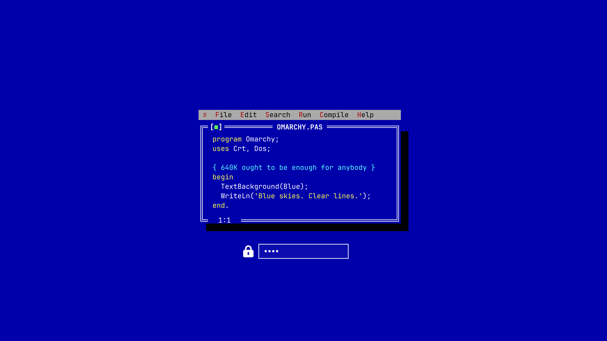

# Turbo Pascal Theme Extras for Omarchy

Two add-ons for [keylimesoda/omarchy-turbo-pascal-theme](https://github.com/keylimesoda/omarchy-turbo-pascal-theme):

- **Unlock screen** – `unlock.png` (and its `preview-unlock.png`), used by Omarchy
  for the Plymouth boot / disk-unlock screen.
- **Panoramic background** – `backgrounds/19-panorama-night.png` (4520×1920) for
  ultrawide / panoramic monitors.



## Install / update

Run this to install the theme with full styling, or to update it later. It
downloads this repo to a temporary folder, runs `install.sh`, and cleans up:

```bash
tmp=$(mktemp -d) && git clone --depth 1 https://github.com/keasbeexd/omarchy-turbo-pascal-extras.git "$tmp" && "$tmp/install.sh"; rm -rf "$tmp"
```

Run it as your normal user, not with `sudo`. It asks for your sudo password once,
when it sets the boot screen.

`install.sh` runs the full update process:

```bash
omarchy theme install https://github.com/keylimesoda/omarchy-turbo-pascal-theme.git
rm -rf ~/.config/omarchy/themes/turbo-pascal/.git
# copy unlock.png, preview-unlock.png and backgrounds/ into the theme folder
omarchy theme set turbo-pascal
omarchy theme bg set ~/.config/omarchy/themes/turbo-pascal/backgrounds/19-panorama-night.png
omarchy-plymouth-set-by-theme turbo-pascal
```

### Why reinstall instead of `omarchy theme update`?

The theme only loads its full styling once its `.git` folder is removed
([see the theme's README](https://github.com/keylimesoda/omarchy-turbo-pascal-theme#install)).
Without `.git`, `omarchy theme update` skips the theme, so updating means
installing a fresh copy. That replaces the whole theme folder, which also
deletes the extras, so they're copied back in afterwards.

Deleting `.git` lets Omarchy run the theme's scripts. The upstream README
recommends reviewing the theme's code first, so check its changes before
running an update.

### Options

Add these after `install.sh` in the command above:

| Option | Effect |
|---|---|
| `--extras-only` | Don't reinstall the theme; just recopy the extras and reapply it |
| `--no-plymouth` | Skip setting the boot screen (no sudo prompt) |
| `--keep-bg` | Don't switch to the panoramic background |

## Where the files go

| File in this repo | Destination |
|---|---|
| `unlock.png` | `~/.config/omarchy/themes/turbo-pascal/unlock.png` |
| `preview-unlock.png` | `~/.config/omarchy/themes/turbo-pascal/preview-unlock.png` |
| `backgrounds/19-panorama-night.png` | `~/.config/omarchy/themes/turbo-pascal/backgrounds/` |

Files are copied rather than symlinked, because Omarchy refuses a symlinked
`unlock.png`.

## Using the panoramic background

`install.sh` switches to it automatically (unless you pass `--keep-bg`).
To cycle through the theme's backgrounds afterwards:

```bash
omarchy theme bg next
```
